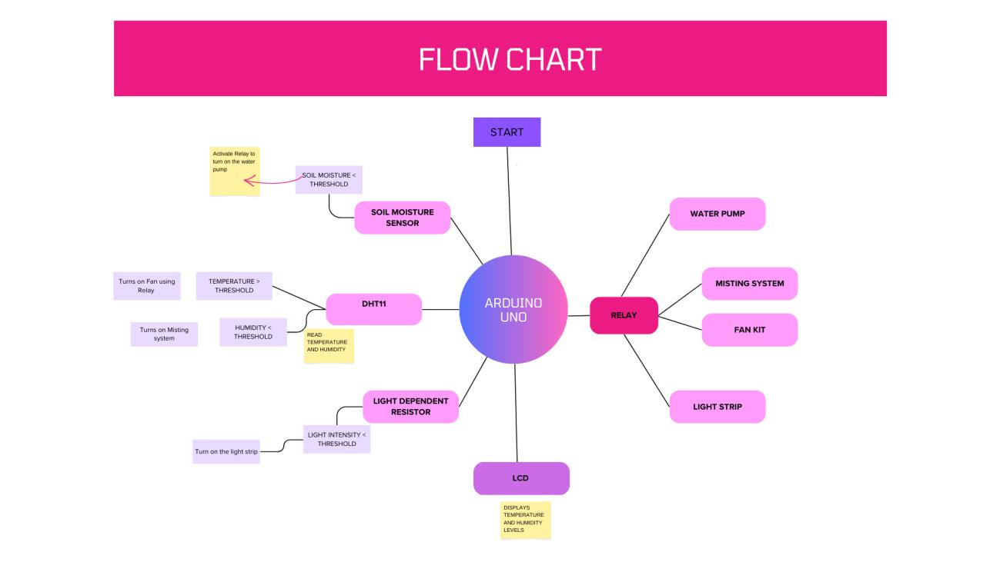
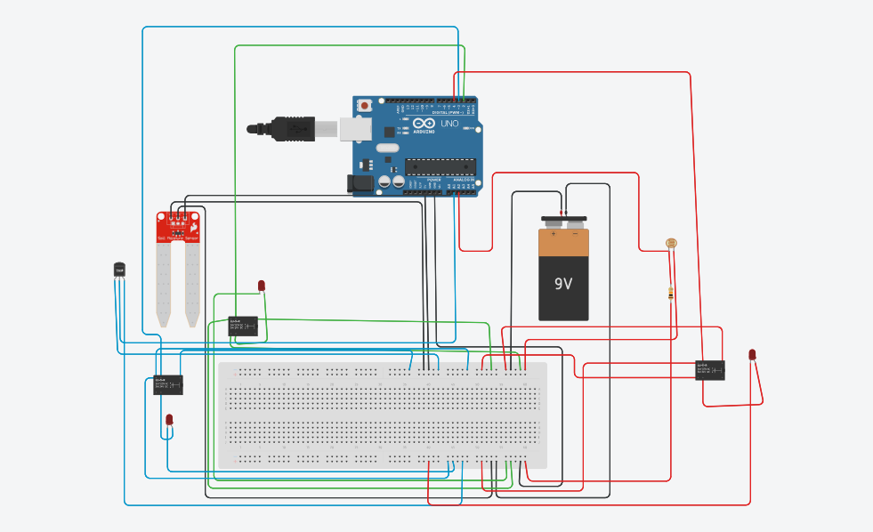
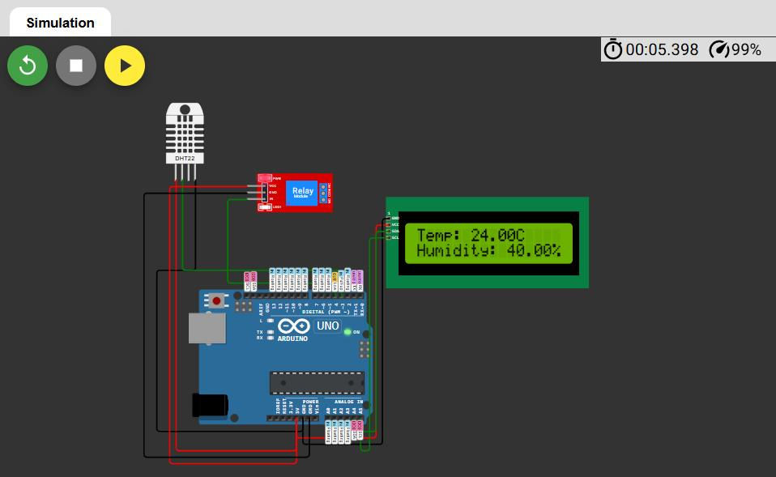

# Smart Greenhouse Automation System (Arduino)

An Arduino Uno based system that monitors temperature, humidity, soil moisture and light intensity in a greenhouse and switches a fan, water pump and grow light automatically using relays. Built for the Electronics Product Engineering Workshop (ECP307) at VNIT Nagpur.



## Overview
Sensors feed an Arduino Uno, which compares the readings against thresholds and drives actuators through relay modules. Temperature and humidity are shown on an I2C LCD. The goal is to keep plant conditions stable with minimal manual work.

## My Role
Co-author of the project report and member of the five-person team (see the [report](docs/report.pdf) for the full author list). This repository packages the team's design, sketches and results; the integrated sketch in `firmware/greenhouse_controller/` was prepared by me from the team's two original sketches.

## Features
| Condition | Sensor | Action |
|---|---|---|
| Soil moisture below threshold | Soil moisture sensor | Water pump ON |
| Temperature above threshold | DHT (temperature) | Fan ON via relay |
| Light below threshold | LDR | Grow light ON via relay |
| Always | DHT + I2C LCD | Show temperature and humidity |

## Hardware
- Arduino Uno
- DHT sensor (DHT22 in the simulation and sketches; the report text mentions DHT11)
- Soil moisture sensor, LDR
- Relay modules driving a fan, water pump and light strip
- 16x2 I2C LCD (address 0x27)
- 2 x 9V batteries with a 1N4007 diode for reverse-current protection

## Circuit and simulation


The temperature/humidity display was simulated before building:



## Firmware
```
firmware/
├── greenhouse_controller/        integrated sketch (use this one)
└── original_sketches/
    ├── soil_light_temp_control/  original soil/temperature/light sketch from the report
    └── lcd_dht22_relay/          original DHT22 + LCD + relay sketch from the report
```
The report's two sketches both used pins D3 and D4, so they could not run together. The integrated sketch moves the DHT sensor to D5 and uses the DHT reading (30 C threshold) for the fan. See the comments at the top of `greenhouse_controller.ino` for every change.

### Libraries
Install from the Arduino Library Manager: **DHT sensor library** and **Adafruit Unified Sensor** (Adafruit), and **LiquidCrystal I2C**.

### Upload
1. Open `firmware/greenhouse_controller/greenhouse_controller.ino` in the Arduino IDE.
2. Select **Arduino Uno** and the correct port.
3. Upload and open the Serial Monitor at 9600 baud.

## Results
From the project report: temperature and humidity were displayed on the LCD, the fan relay switched when the temperature threshold was exceeded, the pump was triggered by low soil moisture, and the light switched on in low light. See the [report](docs/report.pdf) for details.

## Known gaps
- The flow chart and report include a **misting system** triggered by low humidity, but the provided sketches do not implement humidity control.
- The integrated sketch has not been re-tested on hardware. The original sketches were run in simulation and on the team's circuit; the pin change for the DHT sensor should be matched to the actual wiring.
- Sensor polarity: depending on the module, a higher analog reading can mean drier soil or a darker room. The comparisons were kept as in the original sketches and should be checked against the real sensors.

## Future work
Soil nutrient and pH sensors, a DHT22 upgrade where DHT11 is used, solar power, wireless/IoT monitoring, and machine-learning based prediction of watering and lighting needs.

## Documents
- [Project report](docs/report.pdf)

## License
MIT
